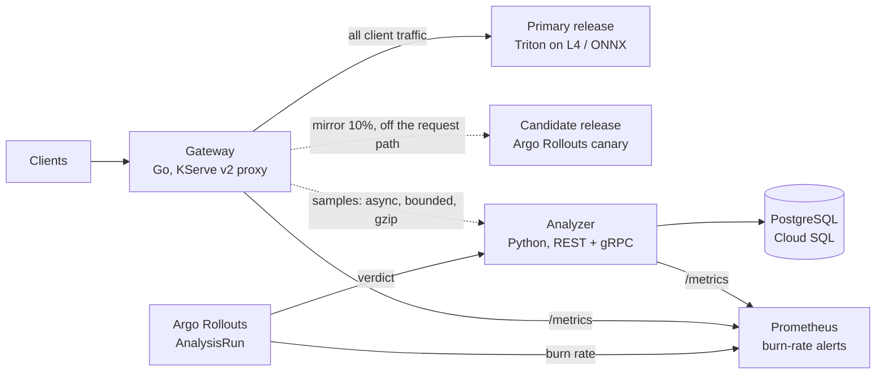

# Bellwether

**A reliability layer for multi-modal model serving.** A Go gateway in front of
Triton (or any KServe v2 server) mirrors live traffic to candidate releases and
samples it to an analyzer that enforces data contracts, detects input and
output drift with a calibrated false alarm rate, and returns a shadow-canary
verdict that Argo Rollouts uses to promote or abort a release on GKE.

It catches the failures health checks miss: a client that starts sending BGR
frames, a resize bug, frozen cameras, a locale launch, a malformed SDK, a
post-processing bug, and the retrained encoder that returns 200s at normal
latency while silently moving every vector in your index.



## Results

All numbers below were measured on a 2 vCPU Linux VM and are reproducible with
the commands shown (raw output in `bench/results/`).

**Fault detection** (`make bench`): 11 failure types × 30 trials plus 300 clean
control windows, each on fresh seeds, 400-request windows. Fault magnitude and
the share of affected traffic are drawn from fixed ranges per trial, so some
trials are deliberately subtle. The alarm threshold is calibrated on reference
traffic only.

| | Result | 95% CI |
|---|---|---|
| Faults detected | **322 / 330 (97.6%)** | 95.3% to 98.8% |
| False alarms on clean traffic | **0 / 300 (0.0%)** | 0.0% to 1.3% |

| Fault | What it simulates | Detected | Attributed to |
|---|---|---|---|
| exposure_shift | camera exposure or white balance regression (darker by 10 to 40%) | 30/30 | input drift |
| sensor_noise | codec or sensor degradation | 29/30 | input drift |
| resize_blur | resize bug: 2x or 4x downsample, then upsample | 30/30 | input drift |
| channel_swap | client release sends BGR, on 10 to 60% of traffic | 26/30 | input drift 23, output drift 3 |
| frozen_frames | stuck cameras send black, gray or white frames | 30/30 | input drift |
| locale_launch | new locale sends Spanish captions | 30/30 | input drift |
| caption_template | upstream template wraps captions in boilerplate | 30/30 | input drift |
| client_mix | app release moves 15 to 40% of traffic to android | 27/30 | input drift |
| schema_break | SDK sends 48x48 images, FP32 tensors or drops parameters | 30/30 | contract |
| output_corruption | post-processing drops normalization or emits NaN | 30/30 | contract |
| bad_replica | some replicas serve the BGR-regressed build | 30/30 | output drift |

The misses are the weakest settings: about 10% of traffic channel-swapped and
the smallest client-mix shifts.

**Shadow canary drill** (`make e2e`): five model server processes, the
analyzer and the Go gateway, 2,500 requests per candidate with 10% mirrored.

| Candidate | What is wrong with it | Verdict | Failed checks |
|---|---|---|---|
| v2 | nothing: retrain aligned to v1's embedding space | PROMOTE | none |
| v3 | reads images as BGR; healthy by every operational metric | ROLLBACK | image embedding agreement, similarity error |
| v2-slow | +40 ms per request | ROLLBACK | p95 latency |
| v2-errors | 5% of requests fail | ROLLBACK | error budget burn (69x), contract violations |

Afterwards, 800 requests from a client that swapped RGB for BGR opened an
`input_drift` incident (thumbnail, blue-channel and embedding tests).

**Gateway overhead** (`make overhead`): open-loop load measured from intended
send time (no coordinated omission), ~55 KB image requests, Go stub upstreams
with 2 ms service time, load generator, gateway and stubs sharing the same 2
vCPUs.

| Load | Direct p50 / p99 | Added, proxy only p50 / p99 | Added, with 10% mirroring + 5% sampling p50 / p99 |
|---|---|---|---|
| 500 rps | 3.1 / 4.2 ms | +0.5 / +0.5 ms | +0.6 / +3.4 ms |
| 1,000 rps | 3.1 / 4.0 ms | +0.5 / +1.8 ms | +0.7 / +5.5 ms |
| 2,000 rps | 3.3 / 4.7 ms | +0.3 / +3.2 ms | +1.1 / +10.0 ms |

Median overhead stays near a millisecond; the tail is dominated by CPU
contention on a machine this small. No errors and no dropped samples.

**Bundled models**: matched image-caption similarity 0.63 vs 0.00 for
mismatched pairs on 2,000 held-out pairs (`build/models/*/model_card.json`).

## How it works

* **Gateway (Go, no third-party dependencies).** KServe v2 reverse proxy with
  load shedding, shadow mirroring on bounded concurrency behind a circuit
  breaker, non-blocking sampling, W3C trace propagation and Prometheus metrics.
  Nothing the candidate or the analyzer does can slow or fail a client request.
* **Data contracts.** Per-item checks on tensor types and shapes, caption
  length and encoding, parameter values, embedding norms and finiteness,
  status codes. Violations are codes, not exceptions.
* **Drift detection.** 18 two-sample tests per window: Kolmogorov-Smirnov on
  image and text statistics, chi-square on request metadata, and RBF-kernel
  MMD with a gamma-approximated null on model-independent pixel thumbnails and
  on the model's embeddings. The alarm threshold is the 1% quantile of the
  *smallest* p-value over 1,000 simulated clean windows, so the window-level
  false alarm rate is calibrated directly rather than bounded by Bonferroni.
* **Attribution.** Input tests separate "the traffic changed" from "the model
  changed", which decides whether to page the client team or roll back.
* **Shadow canary.** Paired comparisons on identical requests: embedding
  agreement, similarity error, latency, error budget burn and contract
  violations, served to Argo Rollouts as PROMOTE, HOLD or ROLLBACK.
* **SLOs.** 99.9% availability with multi-window, multi-burn-rate alerts
  (Google SRE Workbook), as Prometheus rules and as tested Python.

The full design, including alternatives and limitations, is in
[docs/design.md](docs/design.md); alerts link to [docs/runbook.md](docs/runbook.md).

## Quickstart

Requirements: Python 3.11+, Go 1.24.

```bash
make install          # pip install -e ".[dev,postgres,otlp]"
make models gateway   # build the ONNX releases and the Go binaries
make test test-go     # 61 Python tests, 6 Go packages with the race detector
make run-local        # whole stack on localhost, no Docker
```

Send a request (any client that speaks KServe v2 works):

```bash
python - <<'EOF'
import json, httpx
from bellwether.kserve import build_infer_request
from bellwether.synth import generate
b = generate(1, seed=1)
body = build_infer_request(b.images, b.captions, parameters=b.metadata[0])
print(httpx.post("http://localhost:8080/v2/models/multimodal/infer", json=body).json()["outputs"][2])
EOF
curl -s localhost:8010/v1/models/multimodal/canary/v2/verdict | python -m json.tool
```

Or with Docker: `docker compose -f deploy/compose/docker-compose.yaml up --build`
(adds PostgreSQL, Prometheus with the alert rules, and Jaeger for traces).

## Deploying to GKE

```bash
cd infra/terraform/gke && terraform init -backend-config="bucket=<state-bucket>" && terraform apply -var project_id=<project>
# VPC with Dataplane V2, zonal GKE with an autoscaling L4 GPU pool, Artifact
# Registry, a versioned model bucket, Cloud SQL PostgreSQL on a private IP,
# and Workload Identity for Triton and the analyzer.
make publish-triton BUCKET=<project>-bellwether-models
kubectl create namespace bellwether
kubectl -n bellwether create secret generic bellwether-db --from-literal=url="$(terraform output -raw analyzer_db_url)"
make k8s-render PROJECT_ID=<project> REGION=us-central1 BUCKET=<project>-bellwether-models | kubectl apply -f -
```

Prerequisites in the cluster: Argo Rollouts, kube-prometheus-stack, and
optionally Chaos Mesh for the game days in `deploy/chaos/` (candidate latency,
candidate pod kills, analyzer outage).

To release a model: publish it, then change the Rollout's model repository and
`candidate-version` argument. The Rollout starts canary pods without moving
client traffic, the gateway mirrors to them, and the AnalysisRun promotes or
aborts from the analyzer's verdict and the candidate's burn rate.

## APIs

| Interface | Endpoint |
|---|---|
| Inference (gateway) | `POST /v2/models/{model}/infer` (KServe v2) |
| Ingest | `POST /v1/samples:batch` (gzip JSON) or gRPC `bellwether.v1.AnalyzerService/IngestSamples` (client streaming) |
| Canary verdict | `GET /v1/models/{model}/canary/{version}/verdict`, gRPC `GetCanaryVerdict` |
| Incidents | `GET /v1/models/{model}/incidents`, `POST /v1/incidents/{id}:resolve`, gRPC `ListIncidents` |
| Baseline | `GET /v1/models/{model}/status`, `POST /v1/models/{model}/baseline:relearn` |
| Metrics | gateway `:9091/metrics`, analyzer `:8010/metrics` |

## Repository layout

```
gateway/                 Go gateway, load generator, stub model (go test -race)
proto/                   gRPC API (bellwether.v1.AnalyzerService)
src/bellwether/
  analyzer/              contracts, drift tests, calibration, canary, SLOs, storage, REST, gRPC
  models/                ONNX encoders, CCA heads, Procrustes alignment, Triton repository
  modelserver/           KServe v2 HTTP server on ONNX Runtime (Triton stand-in)
  bench/                 fault injection, end-to-end drill, overhead benchmark
deploy/
  k8s/base, overlays/gke Kustomize: Rollout, AnalysisTemplate, HPA, PDB, NetworkPolicies, PodMonitors, PrometheusRule
  prometheus/rules.yml   recording and burn-rate alert rules (source of truth)
  chaos/                 Chaos Mesh game days
  compose/               local Docker stack
infra/terraform/gke/     GKE, L4 node pool, Cloud SQL, Artifact Registry, GCS, Workload Identity
docs/                    design doc and runbook
```

## Verification status

Run in development: all Python and Go tests (including the PostgreSQL 16
integration test), the three benchmarks above, Kustomize rendering of both
overlays with schema validation of all 41 objects (core types plus the Argo
Rollouts, Prometheus Operator and Chaos Mesh CRDs). Not yet run: the Docker
image builds, `terraform validate`, and a deployment to a real GKE cluster
with Triton; CI (`.github/workflows/ci.yaml`) runs the first two on every push.

## License

MIT
